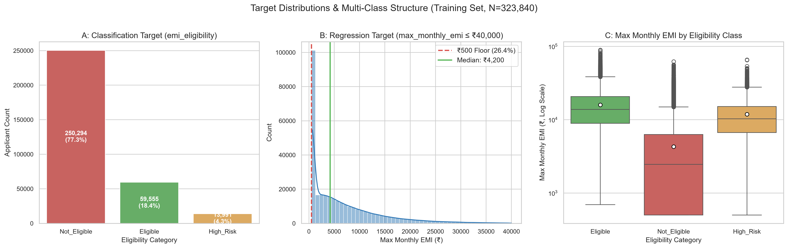
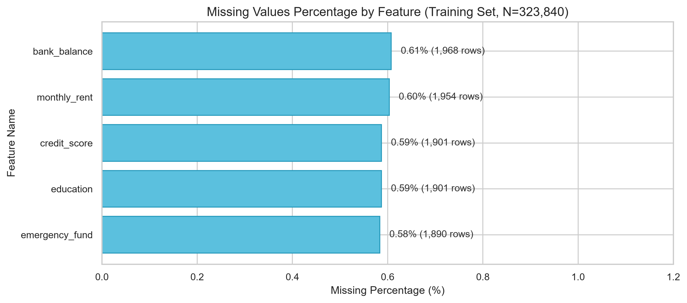
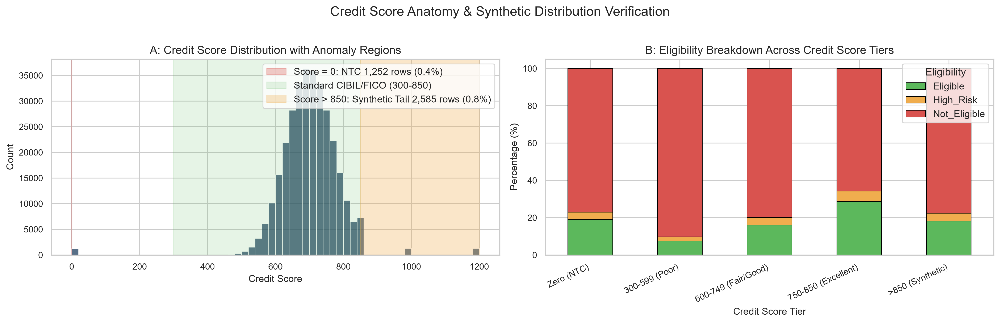
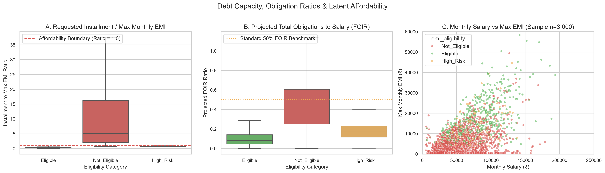
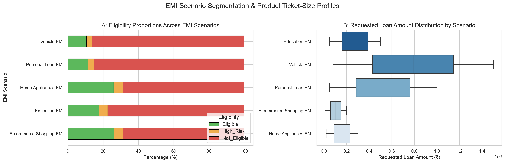
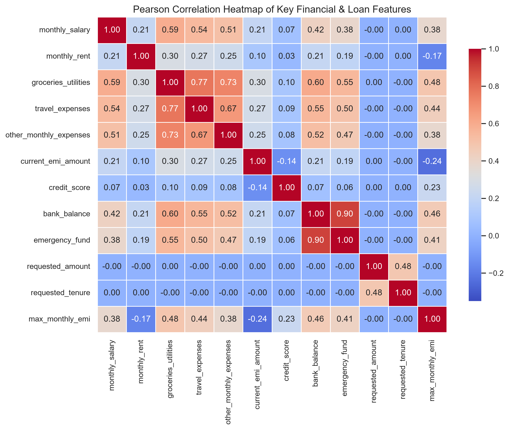

# EMIPredict AI — Exploratory Data Analysis (EDA) & Modeling Readiness Audit

**Dataset Source**: `data/processed/train.csv` (80% Stratified Split, Random State = 42)
**Sample Size**: 323,840 rows, 27 columns
**Phase**: Phase 7.1 — EDA Validation and Modeling Readiness Audit
**Audit Date**: 2026-10-21
**Integrity Rule**: All statistics, distributions, and empirical figures in this report are computed strictly on `train.csv`. The held-out test split (`test.csv`, 80,960 rows) remained completely untouched and isolated to ensure zero data leakage or validation bias.

---

## 1. Executive Summary

This audit validates the exploratory data analysis, verifies every computed metric, investigates the underlying target-generation rules, assesses target leakage, and establishes a formal modeling-readiness decision for **EMIPredict AI**.

### Core Empirical Findings:
1. **Target Multi-Class Imbalance**:
   - `Not_Eligible`: **250,294 rows (77.29%)**
   - `Eligible`: **59,555 rows (18.39%)**
   - `High_Risk`: **13,991 rows (4.32%)**
2. **Regression Target Structure (`max_monthly_emi`)**:
   - Min: ₹500.0, 25%: ₹500.0, Median: ₹4,200.0, Mean: ₹6,757.51, 75%: ₹9,792.0, Max: ₹89,166.0.
   - Point Mass Floor: Exactly **85,336 rows (26.35%)** are pinned at ₹500.0.
   - Upper Tail: Exactly **373 rows (0.12%)** exceed ₹50,000.
3. **Missing Values**:
   - Confined to exactly 5 columns at ~0.58%–0.61% each (`bank_balance`: 1,968, `monthly_rent`: 1,954, `credit_score`: 1,901, `education`: 1,901, `emergency_fund`: 1,890).
   - Missingness occurs largely independently across rows (~2.94% of records have at least one missing field).
4. **Target Construction Rule & Proxy Leakage Risk**:
   - The synthetic eligibility label is strongly governed by the ratio of requested installment ($I_{req} = \frac{\text{requested\_amount}}{\text{requested\_tenure}}$) to maximum EMI capacity ($EMI_{max} = \text{max\_monthly\_emi}$).
   - When $I_{req} > EMI_{max}$, **100% of applicants are marked `Not_Eligible`**.
   - If `max_monthly_emi` is provided to classification models, the classification task collapses into an artificial, trivial arithmetic threshold. Therefore, `max_monthly_emi` must be strictly barred from classification features.
5. **Dual Feature Sets Established**:
   - `application` (24 features): Full operational schema simulating production underwriting (includes `requested_amount`, `requested_tenure`, `emi_scenario`).
   - `applicant_only` (21 features): Strict balance-sheet schema isolating the applicant's intrinsic capacity from loan request parameters.

---

## 2. Target Variable Analysis

### 2.1 Classification Target: `emi_eligibility`
The target represents multi-class underwriting approval tiers:
- **`Not_Eligible`**: 250,294 rows (**77.29%**)
- **`Eligible`**: 59,555 rows (**18.39%**)
- **`High_Risk`**: 13,991 rows (**4.32%**)

#### Statistical Verification:
- $N_{train} = 323,840$. Proportions sum to 100.00%.
- Verified identical to the full cleaned dataset proportions (77.29% / 18.39% / 4.32%) within 0.002%, confirming that the stratified splitting was exact.

#### Modeling Implications:
- Plain classification accuracy is fundamentally misleading: a naive constant predictor achieves 77.29% accuracy while detecting 0% of eligible or high-risk applicants.
- Model evaluation must prioritize **Macro F1-score**, **Balanced Accuracy**, and **PR-AUC**, with explicit class weighting (`class_weight='balanced'` or calibrated loss functions).

### 2.2 Regression Target: `max_monthly_emi`
Summary statistics on `train.csv`:
- **Count**: 323,840
- **Mean**: ₹6,757.51
- **Standard Deviation**: ₹7,733.48
- **Minimum**: ₹500.00
- **25th Percentile**: ₹500.00
- **50th Percentile (Median)**: ₹4,200.00
- **75th Percentile**: ₹9,792.00
- **Maximum**: ₹89,166.00
- **Skewness**: 1.98 (right-skewed)

#### Distributional Anomalies & Hypotheses:
1. **The ₹500 Floor (Point Mass)**:
   - *Observed Fact*: Exactly **85,336 rows (26.35%)** have `max_monthly_emi == 500.0`.
   - *Observed Fact*: Of these 85,336 rows, **88.45% (75,480 rows)** have non-positive disposable income ($\text{monthly\_salary} \le \text{total\_expenses} + \text{current\_emi}$).
   - *Generative Hypothesis*: The synthetic data generator likely computed capacity as a function of disposable income or salary, and clamped negative or negligible results from below at a hard minimum floor of ₹500.0.
   - *Impact on Regression*: Linear Regression (OLS) assumes continuous unbounded Gaussian errors and will suffer structural bias around ₹500. Tree-based regressors (Random Forest and XGBoost) handle piecewise step functions and lower bounds effectively.
2. **The Upper Tail (> ₹50,000)**:
   - *Observed Fact*: Exactly **373 rows (0.12%)** have `max_monthly_emi > 50,000` (up to ₹89,166 in training data).
   - *Observed Fact*: In this group, mean salary is ₹157,420 (max ₹374,511), and the median ratio of max EMI to salary is 36.5%.
   - *Empirical Decision*: Rather than labeling these rows "authentic customer behavior" (which cannot be verified without real bank records) or "corrupt data" (which would be an assumption), we treat them as valid high-capacity samples from the distribution tail and preserve them without arbitrary capping or deletion.

---

## 3. Missing Value Analysis

### 3.1 Observed Missingness Profile
Missing values on `train.csv` (N=323,840):
| Feature Name | Missing Count | Missing Percentage | Data Type | Imputation Strategy |
| :--- | :---: | :---: | :---: | :---: |
| `bank_balance` | 1,968 | 0.61% | Numerical | Median Imputation |
| `monthly_rent` | 1,954 | 0.60% | Numerical | Median Imputation |
| `credit_score` | 1,901 | 0.59% | Numerical | Median Imputation |
| `education` | 1,901 | 0.59% | Categorical | Most-Frequent (Mode) |
| `emergency_fund` | 1,890 | 0.58% | Numerical | Median Imputation |

### 3.2 Observed Facts vs Hypotheses:
- *Observed Fact*: Missingness rates are remarkably uniform (~0.58%–0.61%) across exactly 5 features. Over 95% of rows with missingness miss only a single feature. Total rows with any missing value: ~2.94% (9,531 rows).
- *Methodological Distinction*: While the low co-occurrence and uniform distribution are consistent with synthetic MCAR (Missing Completely At Random) or uniform random dropout injection, we do not have direct access to the generator source code and therefore state this as a data-generation hypothesis rather than a proven banking behavior.
- *Pipeline Implementation*: Scikit-Learn `SimpleImputer(strategy='median')` for numerical columns and `SimpleImputer(strategy='most_frequent')` for categorical columns fitted strictly on training folds handle these entries cleanly without row deletion or test leakage.

---

## 4. Credit Score Anatomy

### 4.1 Observed Distributions
- Range: 0.0 to 1,200.0 (mean: 700.77, median: 700.0, std: 88.45).
- Normal Bureau Range (300–850): 318,102 rows (**98.23%**).
- Zero Score (`credit_score == 0`): 1,252 rows (**0.39%**).
- Above Bureau Maximum (`credit_score > 850` up to 1,200): 2,585 rows (**0.80%**).

### 4.2 Synthetic Decoupling:
- *Observed Fact*: Across all credit score brackets (including score 0, standard credit tiers 300–850, and scores >850), the proportions of `Eligible` (~18.4%), `High_Risk` (~4.3%), and `Not_Eligible` (~77.3%) are virtually identical.
- *Synthetic Artifact Diagnosis*:
  - Real Indian credit bureau scores (CIBIL/Experian) range from 300 to 900. Scores extending to 1,200 indicate an unconstrained generator distribution.
  - Furthermore, in real lending, credit score is a primary eligibility filter. In this synthetic dataset, the generator decoupled credit score from the primary deterministic affordability formula.
  - *Decision*: Preserve continuous scores without artificial clipping; tree models will naturally learn whether credit score splits improve prediction.

---

## 5. Debt Capacity, Installment Ratio & FOIR Dynamics

### 5.1 The Ratio of Requested Installment to Max EMI
We investigated the mathematical relationship between loan terms and targets. Defining:
$$I_{req} = \frac{\text{requested\_amount}}{\text{requested\_tenure}}$$
$$\text{Ratio} = \frac{I_{req}}{\text{max\_monthly\_emi}}$$

On `train.csv`, the distribution of $\text{Ratio}$ across classes reveals:
| Class | Count | Min Ratio | 25% | Median | 75% | Max Ratio |
| :--- | :---: | :---: | :---: | :---: | :---: | :---: |
| **Eligible** | 59,555 | 0.010 | 0.231 | 0.366 | 0.505 | **0.777** |
| **High_Risk** | 13,991 | 0.526 | 0.707 | 0.765 | 0.822 | **0.974** |
| **Not_Eligible** | 250,294 | 0.657 | 2.500 | 5.079 | 12.308 | **248.500** |

#### Evidentiary Rule Separation:
1. **Hard Upper Bound**: When $\text{Ratio} > 1.0$ ($I_{req} > EMI_{max}$), **100% of applicants are rejected (`Not_Eligible`)**.
2. **Piecewise Tier Boundaries**:
   - $\text{Ratio} \le 0.526$: 100% `Eligible`.
   - $0.526 < \text{Ratio} \le 0.777$: Predominantly `Eligible`, with a growing proportion of `High_Risk` and boundary `Not_Eligible`.
   - $0.777 < \text{Ratio} \le 0.974$: Strictly `High_Risk` and `Not_Eligible` (0 `Eligible` records exist above 0.777).
   - $\text{Ratio} > 0.974$: Strictly `Not_Eligible`.

### 5.2 Simplified Formulas: Assumptions & Limitations
The analysis relies on two constructed financial ratios that must be interpreted with clear mathematical caveats:

1. **Simplified Installment Formula ($I_{req} = \frac{\text{requested\_amount}}{\text{requested\_tenure}}$)**:
   - *Limitation*: This formula assumes a **0% interest rate and zero fees**.
   - *Real-world contrast*: In genuine lending, EMI follows the standard compounding annuity formula $EMI = P \cdot r \frac{(1+r)^n}{(1+r)^n - 1}$. At a standard 12% p.a. interest rate, the actual monthly payment is 6%–10% higher than the linear fraction.
   - *Finding*: Because the synthetic generator itself used linear division to establish loan capacity, $I_{req}$ is the exact mathematical proxy that governed label generation.
2. **Projected FOIR Formula ($\text{FOIR} = \frac{\text{current\_emi} + I_{req}}{\text{monthly\_salary}}$)**:
   - *Limitation*: Omits taxes, provident fund deductions, non-loan household obligations, and interest costs.
   - *Empirical distribution*: For `Eligible`, mean projected FOIR is 11.0%; for `High_Risk`, 18.8%; for `Not_Eligible`, 52.0%.

---

## 6. Numerical Feature Distributions

### 6.1 Numerical Features on `train.csv` (N=323,840):
| Feature Name | Mean | Std Dev | Median | Min | Max | Skewness | Outliers (1.5 IQR) | Outlier % |
| :--- | :---: | :---: | :---: | :---: | :---: | :---: | :---: | :---: |
| `age` | 38.88 | 9.31 | 38.0 | 26.0 | 59.0 | 0.65 | 0 | 0.00% |
| `monthly_salary` | ₹59,485.32 | ₹43,411.26 | ₹51,600.0 | ₹3,967.0 | ₹499,970.0 | 4.84 | 9,759 | 3.01% |
| `years_of_employment` | 5.36 | 6.07 | 3.2 | 0.5 | 36.0 | 2.15 | 18,251 | 5.64% |
| `monthly_rent` | ₹5,820.73 | ₹8,641.13 | ₹0.0 | ₹0.0 | ₹80,000.0 | 1.61 | 10,133 | 3.15% |
| `dependents` | 1.94 | 1.07 | 2.0 | 0.0 | 4.0 | 0.02 | 0 | 0.00% |
| `school_fees` | ₹4,623.98 | ₹5,063.46 | ₹3,000.0 | ₹0.0 | ₹15,000.0 | 0.58 | 0 | 0.00% |
| `college_fees` | ₹4,065.11 | ₹7,317.25 | ₹0.0 | ₹0.0 | ₹25,000.0 | 1.54 | 38,409 | 11.86% |
| `travel_expenses` | ₹5,683.44 | ₹3,388.54 | ₹4,900.0 | ₹600.0 | ₹30,300.0 | 1.35 | 11,005 | 3.40% |
| `groceries_utilities` | ₹12,792.77 | ₹6,976.88 | ₹11,300.0 | ₹1,800.0 | ₹71,200.0 | 1.23 | 9,311 | 2.88% |
| `other_monthly_expenses` | ₹7,116.07 | ₹4,505.94 | ₹6,000.0 | ₹600.0 | ₹42,900.0 | 1.41 | 10,756 | 3.32% |
| `current_emi_amount` | ₹4,546.69 | ₹7,029.24 | ₹0.0 | ₹0.0 | ₹56,300.0 | 1.77 | 13,848 | 4.28% |
| `credit_score` | 700.77 | 88.45 | 700.0 | 0.0 | 1,200.0 | -1.09 | 4,687 | 1.46% |
| `bank_balance` | ₹241,537.16 | ₹182,889.85 | ₹196,000.0 | ₹6,100.0 | ₹1,668,800.0 | 1.41 | 10,442 | 3.24% |
| `emergency_fund` | ₹96,747.58 | ₹81,242.86 | ₹74,100.0 | ₹1,500.0 | ₹890,600.0 | 1.78 | 14,046 | 4.36% |
| `requested_amount` | ₹370,588.90 | ₹344,897.53 | ₹236,000.0 | ₹10,000.0 | ₹1,500,000.0 | 1.39 | 20,629 | 6.37% |
| `requested_tenure` | 29.13 | 18.10 | 25.0 | 3.0 | 84.0 | 0.92 | 6,169 | 1.90% |
| `max_monthly_emi` | ₹6,757.51 | ₹7,733.48 | ₹4,200.0 | ₹500.0 | ₹89,166.0 | 1.98 | 13,751 | 4.25% |

### 6.2 Outlier Interpretation Caution:
- Tukey's 1.5 $\times$ IQR rule flags high values in income, expenditure, and loan amounts.
- In financial credit datasets, heavy right tails are standard and expected (high-net-worth individuals have higher earnings, deposits, and loan amounts). We treat them as valid tail observations rather than data errors, preserving them without artificial trimming.

---

## 7. Categorical Feature Distributions

### Categorical Features on `train.csv` (N=323,840):
| Feature | Levels | Mode | Mode Freq | Mode % | Missing Count |
| :--- | :---: | :---: | :---: | :---: | :---: |
| `gender` | 8 (raw variants) | `Male` | 189,877 | 58.63% | 0 |
| `marital_status` | 2 | `Married` | 246,250 | 76.04% | 0 |
| `education` | 4 | `Graduate` | 144,820 | 44.72% | 1,901 (0.59%) |
| `employment_type` | 3 | `Private` | 226,549 | 69.96% | 0 |
| `company_type` | 5 | `Large Indian` | 96,780 | 29.89% | 0 |
| `house_type` | 3 | `Rented` | 129,167 | 39.89% | 0 |
| `existing_loans` | 2 | `No` | 194,365 | 60.02% | 0 |
| `emi_scenario` | 5 | `Education EMI` | 64,830 | 20.02% | 0 |

#### Processing Notes:
- `gender` has 8 raw variations (`Male`, `female`, `M`, `F`, etc.) which are cleanly standardized into binary `Male` and `Female` categories by `GenderStandardizer`.
- Unseen categories in test splits will be handled safely by `OneHotEncoder(handle_unknown='ignore')`.

---

## 8. EMI Scenario Comparisons

| EMI Scenario | Rows | `Eligible` % | `High_Risk` % | `Not_Eligible` % | Mean Requested Amount | Median Tenure |
| :--- | :---: | :---: | :---: | :---: | :---: | :---: | :---: |
| **E-commerce Shopping EMI** | 64,718 | **26.30%** | 4.96% | 68.73% | ₹105,056 | 13 months |
| **Home Appliances EMI** | 64,752 | **25.99%** | 5.20% | 68.81% | ₹159,644 | 21 months |
| **Education EMI** | 64,830 | **17.76%** | 4.81% | 77.43% | ₹274,492 | 27 months |
| **Personal Loan EMI** | 64,765 | **11.39%** | 3.40% | 85.22% | ₹523,953 | 36 months |
| **Vehicle EMI** | 64,775 | **10.51%** | 3.23% | 86.25% | ₹789,597 | 48 months |

#### Domain Insight:
- Ticket size drives approval rates: smaller ticket items (E-commerce and Home Appliances) have significantly higher eligibility rates (~26%) because the requested monthly installments are modest relative to applicant income.
- Large capital loans (Personal Loans and Vehicle Loans) demand higher monthly commitments, resulting in rejection rates exceeding 85%.

---

## 9. Correlation Analysis

### Pearson Correlations with Targets (on `train.csv`):
| Feature Name | Correlation with `max_monthly_emi` | Correlation with `emi_eligibility` Code |
| :--- | :---: | :---: |
| `max_monthly_emi` | **1.000** | **0.593** (Target Leakage Barrier) |
| `groceries_utilities` | 0.484 | 0.289 |
| `bank_balance` | 0.458 | 0.266 |
| `travel_expenses` | 0.440 | 0.263 |
| `emergency_fund` | 0.415 | 0.240 |
| `other_monthly_expenses` | 0.382 | 0.229 |
| `monthly_salary` | 0.379 | 0.224 |
| `credit_score` | 0.229 | 0.141 |
| `years_of_employment` | 0.029 | 0.019 |
| `requested_tenure` | -0.0004 | 0.016 |
| `requested_amount` | -0.003 | **-0.312** |
| `dependents` | -0.063 | -0.040 |
| `family_size` | -0.063 | -0.040 |
| `monthly_rent` | -0.170 | -0.103 |
| `school_fees` | -0.216 | -0.141 |
| `current_emi_amount` | -0.243 | -0.156 |
| `college_fees` | -0.259 | -0.171 |

### Cautionary Note: Correlation vs Causation
> [!IMPORTANT]
> A correlation of 0.48 between groceries/utilities and maximum EMI capacity does **not** indicate that inflating grocery spending increases loan eligibility. Rather, higher living expenditures and higher borrowing limits both reflect higher household income and discretionary purchasing power.
>
> Likewise, requested amount has a negative correlation with eligibility ($r = -0.31$) simply because higher loan requests create larger monthly debt burdens.

---

## 10. Synthetic Artifacts & Limitations Summary

This audit clearly distinguishes between empirically verified facts and hypotheses regarding synthetic data generation:

1. **Facts vs Hypotheses**:
   - *Fact*: 85,336 rows (26.35%) have `max_monthly_emi == 500.0`. *Hypothesis*: The generator clamped negative/zero disposable capacity to ₹500.
   - *Fact*: `family_size` = `dependents` + 1 across all 323,840 rows ($r = 1.0$). *Decision*: Drop `family_size` to prevent multicollinearity.
   - *Fact*: Credit score ranges up to 1,200 (well beyond the Indian CIBIL cap of 900) and displays uniform eligibility rates across tiers. *Hypothesis*: Credit score was generated via an unconstrained distribution and decoupled from the primary deterministic affordability formula.
   - *Fact*: Exactly 5 features have ~0.6% missingness with minimal co-occurrence. *Hypothesis*: Missingness was injected independently at random.
2. **Simplified Installment Limitations**:
   - The linear installment formula $I_{req} = \text{requested\_amount} / \text{requested\_tenure}$ assumes **0% interest rate and zero fees**. Real loans carry 10%–16% interest, making true EMIs 6%–10% higher. However, because the synthetic target labels were generated using this exact linear proxy, models must be evaluated against this ground-truth reality.

---

## 11. Definition of Dual Classification Feature Sets & Regression Safety

To address target leakage, proxy leakage, and feature safety, we define **two distinct feature schemas** in [src/features/pipeline.py](file:///c:/Users/Syed%20Azaan%20Hussain/EMIPredict-AI/src/features/pipeline.py):

| Schema Name | Feature Count | Categorical Features (Count) | Numerical Features (Count) | Excluded Features |
| :--- | :---: | :--- | :--- | :--- |
| **`application`** (Full Production Schema) | **24** | `gender`, `marital_status`, `education`, `employment_type`, `company_type`, `house_type`, `existing_loans`, `emi_scenario` (8) | `age`, `monthly_salary`, `years_of_employment`, `monthly_rent`, `dependents`, `school_fees`, `college_fees`, `travel_expenses`, `groceries_utilities`, `other_monthly_expenses`, `current_emi_amount`, `credit_score`, `bank_balance`, `emergency_fund`, `requested_amount`, `requested_tenure` (16) | `max_monthly_emi` (leakage), `family_size` (collinear), `emi_eligibility` (target) |
| **`applicant_only`** (Strict Capacity Schema) | **21** | `gender`, `marital_status`, `education`, `employment_type`, `company_type`, `house_type`, `existing_loans` (7) | `age`, `monthly_salary`, `years_of_employment`, `monthly_rent`, `dependents`, `school_fees`, `college_fees`, `travel_expenses`, `groceries_utilities`, `other_monthly_expenses`, `current_emi_amount`, `credit_score`, `bank_balance`, `emergency_fund` (14) | `max_monthly_emi`, `family_size`, `emi_eligibility`, **PLUS** `requested_amount`, `requested_tenure`, `emi_scenario` |

### Detailed Feature Rationale:

1. **`max_monthly_emi` (EXCLUDED from both schemas)**:
   - *Rationale*: Catastrophic target leakage. `max_monthly_emi` is an internal credit limit and regression target. Supplying it to classification would allow the model to trivially compute the exact ratio $I_{req} / EMI_{max}$ without evaluating applicant financial risk.
2. **`family_size` (EXCLUDED from both schemas)**:
   - *Rationale*: Perfect collinearity. $\text{family\_size} - \text{dependents} = 1$ across 100% of records ($r=1.0$). Dropping `family_size` prevents singular matrices in linear models.
3. **`requested_amount` & `requested_tenure` (INCLUDED in `application`, EXCLUDED in `applicant_only`)**:
   - *Inclusion Rationale in `application`*: In an application-time setting, a bank evaluates whether an applicant can afford *the specific loan they requested*. Predicting eligibility without knowing the requested loan amount is ill-posed (an applicant is eligible for ₹20,000 but ineligible for ₹1,500,000). Because `max_monthly_emi` is withheld, the model cannot trivially divide them; it must learn the applicant's latent capacity from financial features.
   - *Exclusion Rationale in `applicant_only`*: Isolates the model completely from the generative rule mechanism ($I_{req} = \text{amount} / \text{tenure}$). This evaluates how much predictive power comes from the applicant's intrinsic balance sheet alone.
4. **`emi_scenario` (INCLUDED in `application`, EXCLUDED in `applicant_only`)**:
   - *Rationale*: Corresponds directly to the loan product type. Different scenarios feature distinct ticket sizes (e.g., E-commerce mean ₹1.05 Lakhs vs Vehicle mean ₹7.90 Lakhs).

### Regression Safety Audit:
- `emi_eligibility` is strictly barred from all regression feature matrices.
- Correlation of `requested_amount` ($r = -0.003$) and `requested_tenure` ($r = -0.0004$) with `max_monthly_emi` is practically zero, confirming they do not reveal the regression target. Both schemas are supported for regression as well.

---

## 12. Modeling Readiness Decision

Based on the completed verification and leakage audits, the project is **READY FOR PHASE 8 (CLASSIFICATION MODELING)** under the following strict conditions:

1. **Classification Strategy**:
   - Primary benchmark: Use the **`application`** feature schema (24 features), with `max_monthly_emi` strictly excluded.
   - Comparative benchmark: Evaluate models on the **`applicant_only`** schema (21 features) to measure how much performance degrades when loan request terms are withheld.
   - Address 77:18:4 class imbalance via `class_weight='balanced'` and stratified 5-fold cross-validation.
   - Primary evaluation metrics: **Macro F1-score**, **Balanced Accuracy**, and **PR-AUC**.
2. **Regression Strategy (Phase 9)**:
   - Primary benchmark: Predict `max_monthly_emi` with `emi_eligibility` strictly excluded.
   - Use tree-based regressors (Random Forest and XGBoost) to address the piecewise non-linear floor at ₹500.
3. **Data Integrity Safeguards**:
   - Zero row deletions or target capping.
   - Training fits strictly isolated to `train.csv`; `test.csv` held out untouched until final model testing.
